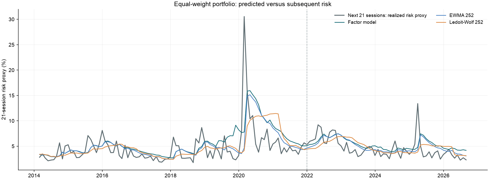
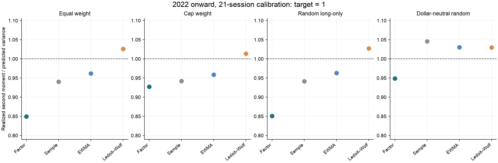
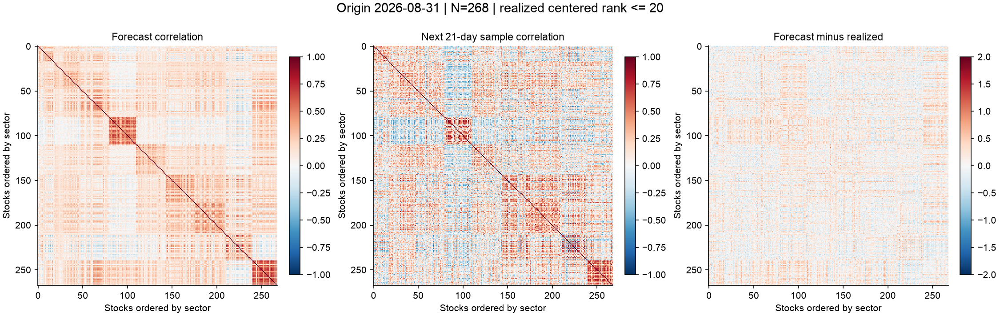

# U.S. Equity Factor Risk Model

A Python research project that builds an interpretable equity risk model and tests how well its covariance forecasts explain subsequent realized risk.

The model combines market, sector and stock-characteristic exposures, estimates daily factor returns with constrained cross-sectional regression, and forecasts stock covariance as

$$\widehat{\Sigma}_t = X_t\widehat{F}_tX_t^\top + \widehat{D}_t.$$

The study uses a **300-stock candidate universe**, estimates **18 daily factor-return series over 3,417 trading sessions**, and evaluates **151 monthly 21-session forecasts** and **149 monthly 63-session forecasts**. The repository includes the research code, tests, frozen evaluation results, figures and one complete forecast/realized matrix example.

## Predicted covariance versus realized risk



Each line uses the same equal-weight portfolio at a given forecast origin. Predicted risk is $`\sqrt{21w^\top\widehat{\Sigma}_tw}`$. The realized proxy is $`\sqrt{21\mathrm{mean}[(w^\top r_{t+1:t+21})^2]}`$, where daily returns are excess returns and the portfolio weights are applied unchanged each day. The units are percentage points of 21-session risk under a constant-daily-risk scaling convention. The dashed line marks the start of the 2022-onward evaluation segment.

## Main results

Evaluation origins run from January 2022 through August 2026 for the primary 21-session horizon, with **56 matched origins** and **237–268 eligible stocks per origin**. The 63-session comparison has 54 matched origins through June 2026.

| Evaluation metric | Factor model | Ledoit–Wolf |
|---|---:|---:|
| 21-session mean Gaussian loss per asset ↓ | **−7.088** | −6.625 |
| 21-session mean relative Frobenius error ↓ | 0.923 | **0.916** |
| 21-session equal-weight variance calibration → 1 | 0.850 | **1.026** |
| 63-session mean Gaussian loss per asset ↓ | **−7.081** | −6.590 |
| 63-session mean relative Frobenius error ↓ | **0.865** | 0.868 |
| 63-session equal-weight variance calibration → 1 | 0.852 | **1.021** |

The factor model recorded lower per-asset Gaussian covariance loss than Ledoit–Wolf at all 56 matched 21-session evaluation origins. Ledoit–Wolf had lower mean 21-session matrix error and equal-weight variance calibration closer to one. Direct EWMA's equal-weight calibration was 0.962 at 21 sessions and 0.956 at 63 sessions. Performance depends on the metric and portfolio.

Calibration is the sum of realized daily second moments divided by the sum of predicted daily variances. A ratio below one means predicted variance was too high on this aggregate measure. A ratio above one means it was too low. These are variance ratios.



The plot shows four estimators of cross-stock covariance. A fifth, diagonal EWMA, is retained in the result tables as a zero-cross-covariance baseline. The full [matrix scores](results/summary.csv) and [portfolio calibration results](results/portfolio_summary.csv) include all five methods and both chronological segments.

The large inverse-based losses for direct sample covariance and EWMA reflect poor conditioning near the 252-observation dimension limit. This occurs even at some formally full-rank origins. Their raw covariance errors and their stabilized inverse-based losses measure different aspects of estimation quality.

## A complete matrix example



The forecast above was made on **August 31, 2026** for **268 stocks**. Its 21-session realized window runs from September 1 to September 30, 2026. The factor model's equal-weight risk proxy was **4.19% predicted versus 2.31% realized**. Heatmaps display correlations for readability. The exported covariance matrices remain in **daily decimal-return-squared units**.

- [Forecast covariance CSV](results/latest_forecast_covariance.csv)
- [Realized centered covariance CSV](results/latest_realized_covariance.csv)
- [Forecast minus realized covariance CSV](results/latest_covariance_difference.csv)
- [Realized second-moment matrix CSV](results/latest_realized_second_moment.csv)
- [Date, units and CSV stock order](results/latest_matrix_pair.json)
- [NPZ archive with all five forecasts and portfolio weights](results/latest_forecast_archive.npz)

The CSVs share the stock order in `latest_matrix_pair.json`. The NPZ uses its own `symbols` array. The offline demo verifies the alignment between them.

## Quick start with the included results

Use Python 3.11 or later. Run these commands from the repository root.

```bash
python -m venv .venv
source .venv/bin/activate
python -m pip install -e .
equity-risk-demo --results results --output artifacts
python -m unittest discover -s tests -v
```

On Windows, activate the environment with `.venv\Scripts\activate`.

The demo runs offline. It verifies artifact hashes, checks the latest matrix exports, recomputes equal-weight risk and selected Gaussian scores, prints the evaluation table, and recreates the risk-history figure in `artifacts/`. A module entry point is also available.

```bash
python -m factor_project.demo --results results --output artifacts
```

For a small portfolio calculation, read the covariance CSV with its stock labels.

```python
import numpy as np
import pandas as pd

covariance = pd.read_csv("results/latest_forecast_covariance.csv", index_col=0)
weights = np.full(len(covariance), 1 / len(covariance))
daily_variance = float(weights @ covariance.to_numpy() @ weights)
risk_21_sessions = np.sqrt(21 * daily_variance)
print(f"Predicted equal-weight risk: {risk_21_sessions:.2%}")
```

## Model construction

### Universe and input timing

The candidate universe contains 100 large-, 100 mid- and 100 small-cap names selected from the November 3, 2026 holdings of iShares IVV, IJH and IJR. Selection rotates across sectors and follows fund weights within each sector, excluding financials and REITs. Historical size exposures use lagged market capitalization. Sector labels are static.

Market history starts in January 2010 and ends on September 30, 2026. Accounting and exposure coverage support successful daily factor estimation from March 1, 2013. Across those dates, daily regressions contain 95–271 stocks, with a median of 198. Forecast eligibility additionally requires complete historical price windows and sufficient residual history.

Annual SEC Company Facts observations must have `filed < exposure_date`. Same-day disclosures are excluded. Financial fields retain filing, period and tag provenance. Share counts use lagged disclosed shares outstanding, with a 180-day staleness limit and documented split adjustments. Missing financial inputs and returns remain missing.

### Exposures and daily factor returns

The model includes one market intercept, nine sector effects, six style factors, a beta control and a dividend-yield descriptor.

| Exposure | Direction and construction |
|---|---|
| Size | Negative log market capitalization, so smaller stocks have higher exposure |
| Momentum | Adjusted price at $`t-21`$ divided by adjusted price at $`t-252`$, minus one |
| Quality | Composite of profitability, cash earnings quality and balance-sheet strength, with at least 3 of 4 components available |
| Growth | Three-year revenue growth and earnings change scaled by assets, requiring both measures |
| Value | Book, earnings and operating cash flow relative to market capitalization, requiring at least 2 of 3 components |
| Low volatility | Negative trailing 252-session return volatility |
| Beta control | Trailing 252-session market beta on matched observed dates |
| Dividend yield | Trailing cash dividends relative to the contemporaneous share price |

Exposures are winsorized, market-cap-centered and standardized at each monthly snapshot. Each subsequent trading day estimates all factor coefficients jointly using

$$r_{i,t}-r_{f,t}=f_{m,t}+f_{s(i),t}+\sum_k X_{i,k,t}f_{k,t}+\epsilon_{i,t}.$$

Weighted least squares minimizes $`\sum_i\sqrt{\mathrm{cap}_{i,t}}\epsilon_{i,t}^2`$. Sector effects satisfy a market-cap-weighted zero-sum constraint. A snapshot becomes usable strictly after its date. The coefficients form the daily factor-return histories used to estimate factor covariance. [Average realized factor coefficients](docs/figures/average_factor_returns.png) are also included.

### Covariance forecasts

| Component | Fixed specification |
|---|---|
| Factor covariance $`\widehat F`$ | Up to 756 past sessions, 63-session exponential half-life, 20% shrinkage toward its own diagonal |
| Specific variance $`\widehat D`$ | Past 252 residual sessions, 63-session half-life, at least 126 observations per stock |
| Direct-return baselines | Sample covariance, EWMA, Ledoit–Wolf and diagonal EWMA, each using 252 past sessions |
| Forecast schedule | Monthly market close |
| Validation horizons | Next 21 and 63 trading sessions |

Every estimator uses the same stocks selected from information available at the origin. Portfolio diagnostics include equal-weight, capitalization-weight, 20 fixed-seed random long-only and 20 random dollar-neutral portfolios. Method-specific minimum-variance portfolios are evaluated separately.

### Evaluation targets

- Centered future sample covariance $`S`$, with `ddof=1`, is used for relative Frobenius error and correlation RMSE.
- The future daily second moment $`M=H^{-1}\sum_{h=1}^H r_{t+h}r_{t+h}^\top`$ is used for zero-conditional-mean Gaussian loss and portfolio calibration.
- Gaussian loss per stock is $`[\log\det(\widehat\Sigma)+\mathrm{tr}(\widehat\Sigma^{-1}M)]/N`$.
- Singular forecast matrices receive a predeclared diagonal jitter for inverse-based scores and optimization. Raw matrix errors use the original covariance estimates. The jitter is recorded at each origin.

The first segment covers 2014–2021, and origins from 2022 onward form the reported evaluation segment. Future windows that cross the segment boundary are excluded from segment summaries. If any frozen stock lacks a future return, the entire horizon is skipped. The ex-ante stock set remains fixed.

## Rebuild from source data

The committed results provide an offline example. Rebuilding the full historical study requires fetching SEC facts, French factor data and public daily prices. The cache directories are excluded from Git.

```bash
python -m pip install -e ".[data]"
export SEC_USER_AGENT="Your Name your-email@example.com"
python -m factor_project.prepare_data --root research
OPENBLAS_NUM_THREADS=1 OMP_NUM_THREADS=1 python -m factor_project.expanded_run --root research
OPENBLAS_NUM_THREADS=1 OMP_NUM_THREADS=1 python -m factor_project.oos_audit --root research
```

Set `SEC_USER_AGENT` to your actual contact information before acquisition. The downloader respects SEC throttling and stops on access-denial or rate-limit responses. It preserves original market downloads and applies the [dated identity rules](research/market_identity_rules.json) to a separate model price cache. The preparation command can reuse completed source downloads on retry.

The full run writes `research/output/report.html`, per-origin NPZ archives, exposure coverage, factor returns and detailed evaluation scores. Once input fingerprints are unchanged, factor estimation can be reused.

```bash
python -m factor_project.expanded_run --root research --reuse-model
python -m factor_project.render_covariance --root research
```

`requirements-research.txt` records the direct dependency versions used in the verified research environment. Public providers can revise historical prices, corporate actions and accounting records. The frozen result files preserve the reported study. A fresh download may produce different inputs and scores.

## Data integrity and limitations

- **Historical universe selection.** The cohort comes from current holdings after the price sample ends. It has survivor and retrospective selection bias. Filing dates are aligned historically, while universe membership and sector labels use the fixed snapshot.
- **Security continuity.** CHRD starts with the new common equity issued after the 2020 restructuring. TGTX starts at its Nasdaq listing. SUPN remains a candidate with no model prices because the downloaded series did not match the accounting issuer. The rules preserve large observed returns in valid histories.
- **Accounting coverage.** Standardized annual XBRL and lagged disclosed shares omit some companies and issuer-specific concepts. They provide a conservative research panel with explicit gaps.
- **Realized-matrix noise.** A 21-session centered covariance has rank at most 20, and a 63-session covariance has rank at most 62. These are noisy proxies for latent future covariance. The evaluation inverts forecast matrices only.
- **Dependence across windows.** Monthly windows can overlap, especially at 63 sessions. The matched-origin result is descriptive and carries no independent-trial significance claim.
- **Portfolio interpretation.** Fixed daily weights imply daily rebalancing. Trading costs, borrow costs and execution constraints are outside the reported diagnostics.
- **Evaluation history.** Model settings were fixed before expanded scoring. Prior pilot analysis, current-universe selection and subsequent source-quality repairs limit how closely the chronological split approximates an untouched prospective test.

## Repository layout

```text
src/factor_project/        Data preparation, exposures, regression, covariance and audit code
tests/                     Timing, missing-data, split and numerical regression checks
research/                  Fixed universe, configuration and security-identity rules
results/                   Frozen derived results and a complete matrix example
docs/figures/              README figures from the validated study
.github/workflows/         Tests and the offline example on GitHub Actions
```

The [artifact manifest](results/artifact_manifest.json) records hashes for the included figures and result files. The [input audit](results/input_audit.json) checked 471,447 financial provenance cells with no filing-date violations. The [independent output audit](results/oos_integrity_audit.json) reconstructed five real forecast origins and checked the exported score summaries. These checks validate timing and numerical consistency within the stated data scope.

Frozen manifests retain the original study's input and code fingerprints. The standalone package adapts acquisition, paths and report presentation while retaining the estimation and evaluation algorithms. A source-data rebuild creates its own input fingerprints and output manifests.

## Sources

- [SEC Company Facts and submissions APIs](https://www.sec.gov/search-filings/edgar-application-programming-interfaces)
- [Kenneth French Data Library](https://mba.tuck.dartmouth.edu/pages/faculty/ken.french/data_library.html) for the daily risk-free rate and market reference series
- [iShares IVV](https://www.ishares.com/us/products/239726/ishares-core-sp-500-etf), [IJH](https://www.ishares.com/us/products/239763/ishares-core-sp-midcap-etf) and [IJR](https://www.ishares.com/us/products/239774/ishares-core-sp-smallcap-etf) for the candidate-cohort snapshot
- Yahoo Finance daily adjusted prices and corporate actions, identified explicitly in cache provenance
- [Ledoit and Wolf](https://www.ledoit.net/Improved_JEF2003.pdf) and the [scikit-learn estimator](https://scikit-learn.org/stable/modules/generated/sklearn.covariance.LedoitWolf.html)
- [Patton and Sheppard](https://public.econ.duke.edu/~ap172/Patton_Sheppard_29oct07.pdf) on covariance-forecast evaluation with noisy realized proxies

The repository contains derived research outputs. Original provider/API histories are fetched into ignored local directories and remain subject to their source terms.
